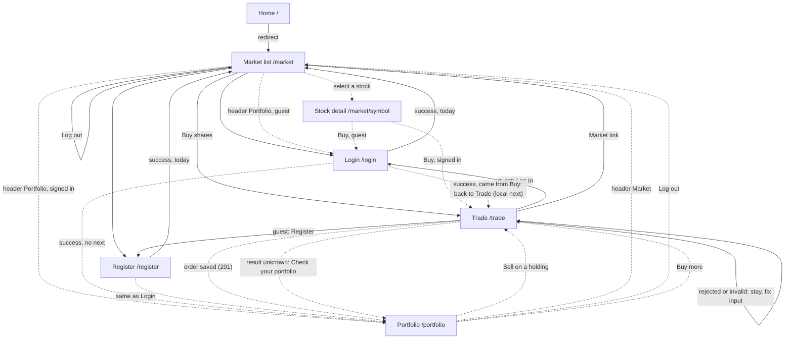

# Milestone 3 - VirtuTrade UI

Planning baseline recorded 10 October 2026 against main commit `a7f24e6`.
PO: @bianh13. Sprint 3 SM: @longbk761-bot. This dossier is in progress:
wireframes, implemented journeys and browser evidence are still required.

## 1. P0 stories and status

Merged-state refresh: 20 October 2026, `main` at `50ff313` (#98/#99/#100 merged).

Statuses describe the implementation observed on `main`, not the ambition of an
issue or the existence of a schema. Old M1/M2 issue closure does not prove a
working M3 journey. Screen names are used consistently below: **Register,
Login, Market list, Stock detail, Trade, Portfolio**. The Notes column
separates what is **implemented on `main`**, what is **planned** (route or
behavior not on `main`) and **open PR work**.

| Story | Screen(s) | Route | Status | Issue | Notes |
| ----- | --------- | ----- | ------ | ----- | ----- |
| US01 - Register / sign in | Register, Login | `/register`, `/login` | partly works | [#77](https://github.com/SE-FDA-NEU-AI66B/AI66B-Group-5-A4-Investment-and-Portfolio-Management-Simulation/issues/77) | Implemented: both pages, session cookie, CSRF, lockout; #105 sends form login to the Portfolio once its real GET route exists (#81), otherwise to the Market list; registration still lands on the Market list. Planned: return to the page the guest came from via a local `next` (proposed). |
| US02 - Initial virtual capital | Register, Market list, Trade | `/register`, `/market`, `/trade` | partly works | [#78](https://github.com/SE-FDA-NEU-AI66B/AI66B-Group-5-A4-Investment-and-Portfolio-Management-Simulation/issues/78) | On main: 100,000,000 VND granted once at registration; Trade shows cash. Merged PR #99: Market-header balance, additional tests and [author screenshot](https://github.com/SE-FDA-NEU-AI66B/AI66B-Group-5-A4-Investment-and-Portfolio-Management-Simulation/blob/7dcd74f/docs/images/ui/grant-balance.png). Planned: Portfolio balance (#81). |
| US03 - Find a stock and inspect its quote | Market list, Stock detail | `/market`, `/market/<symbol>` | partly works | [#85](https://github.com/SE-FDA-NEU-AI66B/AI66B-Group-5-A4-Investment-and-Portfolio-Management-Simulation/issues/85) | Implemented: Market list only. Planned (#85): search (`?q=`, proposed) and Stock detail. No additional implementation PR is listed in this snapshot. |
| US04 - Buy shares | Market list, Trade | `/market`, `/trade` | partly works | [#76](https://github.com/SE-FDA-NEU-AI66B/AI66B-Group-5-A4-Investment-and-Portfolio-Management-Simulation/issues/76) | Implemented on main via #92: Market Buy shares link, guest guard, authenticated preview and purchase receipt. Planned: Stock detail entry and Portfolio transition (#81). |
| US05 - Sell shares | Portfolio, Trade | `/portfolio`, `/trade?side=sell&symbol=HPG` | partly works | [#79](https://github.com/SE-FDA-NEU-AI66B/AI66B-Group-5-A4-Investment-and-Portfolio-Management-Simulation/issues/79) | Merged PR #98: sell preview/confirm, partial/full sale and oversell warning; [author browser evidence](https://github.com/SE-FDA-NEU-AI66B/AI66B-Group-5-A4-Investment-and-Portfolio-Management-Simulation/tree/28fe0ee/docs/images/ui) from 19 October. Planned: Sell entry from a Portfolio holding (#81). |
| US06 - View portfolio | Portfolio | `/portfolio` | not started | [#81](https://github.com/SE-FDA-NEU-AI66B/AI66B-Group-5-A4-Investment-and-Portfolio-Management-Simulation/issues/81) | Planned: a "Portfolio" header link for signed-in users. |
| US10 - Insufficient-balance warning | Trade | `/trade` | partly works | [#76](https://github.com/SE-FDA-NEU-AI66B/AI66B-Group-5-A4-Investment-and-Portfolio-Management-Simulation/issues/76) | Implemented on main via #92: inline shortfall, disabled confirmation and correction. Final independent P0 journey evidence remains pending. |

On `main` today: `/` redirects to Market list; Register, Login and Log out are
reachable from the Market list header, which also links to the Trade screen for
buying shares. The sell form is available directly at `/trade?side=sell&symbol=HPG`; its Portfolio entry remains pending #81. There is no Portfolio link until #81 lands. Wireframes below show
the target design; the table and flow distinguish implemented and planned paths.

### Screen flow (solid = on `main`, dashed = planned)



The planned Trade → Portfolio path means an order that was **saved**, not a click
on Confirm; the current buy implementation displays its receipt on Trade.
A rejected order keeps the user on Trade with the error beside the input.
The `next` value must be a local path (`/trade?...`), never an external URL.

### Branch verification - 20 October, #101

The UI follow-up supports existing stories; it does not add a new P0 story or
promote a story to **works**. On this branch, each Market row has a Buy link to
`/trade?symbol=...`; the Trade screen searches the existing quote list by symbol
or company and shows a structured preview. The solid arrows above continue to
mean merged `main`; these enhancements are pending review/merge.

The #101 follow-up also applies the red/charcoal presentation to Login and
Register using a shared account template. On mobile the form comes first.
Existing routes, CSRF, server messages and login/register behavior remain
unchanged; this presentation update does not complete the remaining US01 flow.
See [account screenshots and checks](market-buy-ui-evidence.md#account-presentation-follow-up).

| Story | Concrete behavior in this follow-up | Remaining acceptance |
|-------|----------------------------------------|----------------------|
| US03 | Read stored quotes with source/time; choose Buy on the matching row | #85 market search and stock-detail screen remain with Vu |
| US04 | Select a stock using the picker, preview and confirm with real auth/SQLite | #76 Portfolio handoff (#81), review and merge |
| US10 | Show exact shortfall, disable Confirm, recover after correcting quantity | Independent final journey review; no premature works status |

## 2. Wireframes

ASCII drafts live here so they can be reviewed in the PR diff. Final exports
(photo of paper or PNG) go in `docs/images/ui/` and replace the drafts. Every
screen shares one header: **VirtuTrade · Market · Portfolio · Log in / Register
(guest) or email · Log out (signed in)**.

### 2.1 Register - `/register`

*The user comes here to create a private simulation account and receive
100,000,000 VND of virtual cash.*

**Calls:** `POST /api/accounts` (HTML form posts to `POST /register`, same
service). Pre-auth CSRF token is embedded in the form.

```text
+---------------------------------------------------------------+
| VirtuTrade   Market   Log in                                  |
+---------------------------------------------------------------+
| Create your simulation account                                |
| You receive 100,000,000 VND once.                             |
|                                                               |
| [!] Email already in use            <- on error (today)       |
| [!] Enter a valid email address.    <- on error (today)       |
| [!] Passwords must match            <- proposed, see below    |
|                                                               |
| Email                 [______________________]                |
| Password              [______________________]  8-128 chars   |
| Confirm Password      [______________________]  (proposed)    |
| [ Register ]                                                  |
| Already registered? Log in                                    |
+---------------------------------------------------------------+
```

Confirm Password and its error are proposed; the current form has Email and Password only.

### 2.2 Login - `/login`

*The user comes here to open their own account and see only their own data.*

**Calls:** `POST /api/sessions` (form: `POST /login`).

```text
+---------------------------------------------------------------+
| VirtuTrade   Market   Register                                |
+---------------------------------------------------------------+
| Log in to your simulation account                             |
|                                                               |
| [!] Invalid email or password       <- wrong credentials      |
| [!] Account locked. Try again in N seconds.  <- locked        |
|                                                               |
| Email     [______________________]                            |
| Password  [______________________]                            |
| [ Log in ]                                                    |
| Five wrong passwords lock the account for 15 minutes.         |
| Already have account? Register                                |
+---------------------------------------------------------------+
```

### 2.3 Market list - `/market` (four states)

*The user comes here to find a stock by ticker or company name and see whether
its price is fresh.*

**Calls:** `GET /api/market/quotes` (list; designed, JSON owner agreed with #59/#75).
Until the JSON endpoint lands the page renders the same data
server-side from `market_snapshot`. Search uses `GET /market?q=<text>`.

```text
+- Data -----------------------------------------+  +- Empty (no match) ---------------------+
| Search [HPG___________] [Search]               |  | Search [XYZ___________] [Search]       |
|                                                |  |                                        |
| [ Generate demo quotes ]  (simulation mode)    |  | No stocks match "XYZ".                 |
| Symbol  Price    Change  Quote time    Status  |  | [ Clear search ]                       |
| HPG     28,000   +1.82%  09:15 30/09   Seed    |  +----------------------------------------+
|  Hoa Phat Group                  Price may be  |  +- Empty (no quotes at all) -------------+
|  [ View ]                         delayed      |  | No quotes yet.                         |
+------------------------------------------------+  | Market prices appear when available.   |
+- Loading --------------------------------------+  +----------------------------------------+
| Search [HPG___________] [Search] (kept)        |  +- Error ---------------------------------+
|                                                |  |                                         |
| (spinner) Loading prices...                    |  | Market data is unavailable.             |
+------------------------------------------------+  | Search text kept: [HPG___]              |
                                                    | [ Try again ]  (read-only retry)        |
                                                    +-----------------------------------------+
```

Demo data: while no live DNSE feed exists (#59), the P0 market runs on
labelled simulation data. **Generate demo quotes** appears only in simulation
mode, calls `POST /api/simulation/quotes/refresh` (#75), and the Source column
then reads **Simulation / generated** with the generation time. Seed rows keep
the **Demo / seed** label. Simulated data is never called live DNSE data.

Time zone (**proposal, not yet agreed**): the template shows UTC today. Showing
local time with an explicit zone label, e.g. `09:15 30/09/2026 (UTC+7)`, is the
fix #87 will validate against the running screen. Likewise `?q=` is a proposed
query name until #85 and the API owner confirm it.

Rules: search text is preserved on retry and after a failed load; the retry
button appears for transient read failures only; narrow screens stack each row
as a card so price, time and status stay visible without horizontal scrolling.

### 2.4 Stock detail - `/market/<symbol>`

*The user comes here to understand one stock's price, daily movement and
freshness before deciding to buy.*

**Calls:** `GET /api/market/quotes/{symbol}` (designed).

```text
+--------------------------------------------------+
| < Back to market                                 |
|                                                  |
| HPG - Hoa Phat Group                             |
| 28,000 VND   +1.82% vs previous close (27,500)   |
| Quoted 09:15, 30/09/2026 (time zone: see 2.3)    |
| Source: Demo / seed   [Price may be delayed]     |
|                                                  |
| [ Buy ]   (guest -> sent to Log in first)        |
+--------------------------------------------------+
Unknown symbol:  "Ticker not found"  [ Back to market ]
No reference:    change shown as "Reference unavailable"
```

### 2.5 Trade: distinct states, corrected amounts, and sell variants - `/trade`

*The user comes here to preview a virtual order and confirm it. Buy and sell
show separate validation states; an invalid order cannot be confirmed.*

**Calls:** `POST /api/orders/preview`, `POST /api/orders/buy` or
`POST /api/orders/sell`. A failed order POST is never auto-retried.

**Buy, sufficient cash:**

```text
+--------------------------------------------------+
| Buy HPG               Cash: 100,000,000 VND      |
| Quantity [1000]       Quote 28,000 (09:15:00)    |
| Estimated cost: 28,000,000 VND                   |
| [ Confirm buy ]  (enabled)                       |
+--------------------------------------------------+
```

**Buy, insufficient cash (US10 acceptance data):**

```text
+--------------------------------------------------+
| Buy ACB               Cash: 500,000 VND          |
| Quantity [32]         Quote 25,000 (09:15:00)    |
| Estimated cost: 800,000 VND                      |
| [!] Exceeds available balance by 300,000 VND     |
| [ Confirm buy ]  (disabled)                      |
+--------------------------------------------------+
```

**Sell, valid quantity:**

```text
+--------------------------------------------------+
| Sell HPG              You hold: 1,000 shares     |
| Quantity [1000]       Quote 30,000 (09:15:00)    |
| Estimated proceeds: 30,000,000 VND               |
| [ Confirm sell ]  (enabled)                      |
+--------------------------------------------------+
```

**Sell, quantity exceeds shares held:**

```text
+--------------------------------------------------+
| Sell HPG              You hold: 500 shares       |
| Quantity [800]        Quote 30,000 (09:15:00)    |
| Estimated proceeds: 24,000,000 VND               |
| [!] You hold 500 HPG; the maximum you can sell   |
|     is 500                                       |
| [ Confirm sell ]  (disabled)                     |
+--------------------------------------------------+
```

After an order is saved, show its result on the Portfolio page. For example:
"Sold 1,000 HPG at 30,000.\
Proceeds 30,000,000 VND.\
Realised P&L +2,000,000 VND."\
Realised P&L appears only after the order is saved; the preview API does not return it.

Shared states:

```text
Quote stale:     "Generate demo quotes, then preview again"
Result unknown:  "Result unknown. Check your portfolio." (link; no retry)
```

### 2.6 Portfolio - `/portfolio`

*The user comes here to see cash, holdings, average cost and unrealised P&L.*

**Calls:** `GET /api/portfolio`; Sell links to `/trade?side=sell`.

```text
+---------------------------------------------------------------+
| Portfolio        Total: 46,600,000 VND                        |
| Cash: 40,000,000 VND                                          |
| HPG  200 sh           avg 30,000          value 6,600,000     |
|      P&L +600,000 (+10.00%)                                   |
|      [ Sell ] -> /trade?side=sell&symbol=HPG                  |
| Empty: "No positions yet" (total = cash)                      |
+---------------------------------------------------------------+
```

### 2.7 Market-to-Buy presentation follow-up - #101

The user comes here to choose a known stock without memorizing its symbol and
understand the cost before buying. The buy form has a searchable stock picker,
quantity field, Preview and Confirm controls, and a separate order summary.
The summary shows symbol, quantity, unit price, available cash, estimated cost,
remaining cash (or shortfall), quote source and timestamp. A row-level Buy link
preselects the stock. Existing server rules and receipt behavior are unchanged.

Calls: existing `GET /api/market/quotes`, `POST /api/orders/preview`,
`POST /api/orders/buy` and, only in simulation, `POST /api/simulation/quotes/refresh`.
No market search/detail endpoint is introduced by this follow-up.

Picker states: loading text; an empty-list message with Retry; an unavailable
message with Retry/known-symbol fallback; and symbol/company results. No-match
search preserves the entered text. Arrow keys, Enter, Escape and Tab work.
See [observed screens and reproducible checks](market-buy-ui-evidence.md).
These author page captures are not the PDF address-bar screenshots.

## 3. Error messages

Every row separates two things: the **API message**, which is the exact string
in `docs/api-contract.md` and `src/virtutrade/accounts/errors.py`, and the
**UI hint**, a recovery line shown beside it. The API message never changes;
HTML pages and the JSON API share the same string (`accounts/routes.py`,
`_fail`), and the contract and `tests/test_auth.py` depend on it. API error
codes never change either.

**How the hint is added (proposal, implemented under #87 with #77).**
`_fail()` in `accounts/routes.py` currently passes only `exc.message` to the
template. It also passes `exc.code`. The template shows `error` in the alert as
today, and below it the hint looked up by code from one mapping kept in the
module that owns the page (for example a dict in the accounts module). The JSON
envelope built by `_envelope()` is untouched, so JSON clients never receive a
hint. Required tests: the JSON `message` for each implemented code still equals
the contract string and the body has no hint field; the HTML page contains both
the message and its hint. This section documents the design; none of it is
implemented yet.

Test coverage today: `tests/test_auth.py` asserts the message of
`EMAIL_IN_USE`, `INVALID_CREDENTIALS` and `LOGIN_LOCKED`. It asserts only the
code of `ACCOUNT_DISABLED`, and the `VALIDATION_ERROR` messages have no test.

### 3.1 Implemented and reachable through the UI

| API error code | Business rule | API message (unchanged) | UI hint (proposal, #87) |
| -------------- | ------------- | ----------------------- | ----------------------- |
| 409 `EMAIL_IN_USE` | US01 - an email can register only once | Email already in use | Sign in with this email, or register with another one. |
| 401 `INVALID_CREDENTIALS` | US01 - wrong password and unknown email give the same answer | Invalid email or password | Check both fields and try again. |
| 429 `LOGIN_LOCKED` | US01 - five wrong passwords lock the account for 15 minutes | Account locked. Try again in N seconds. (N is the remaining time from the server) | You can sign in again when the countdown ends. |
| 409 `QUOTE_STALE` | BR3 / US04 - stale quotes cannot authorize a buy | Price may be delayed. Generate demo quotes, then preview again. | Recovery is included in this exact simulation-mode message; verified through the real preview endpoint on 20 October, see [buy evidence](buy-acceptance.md). |

Buy/US10 also shows `Exceeds available balance by 12,000,000 VND. Reduce the quantity.`
for the 4,000 HPG fixture, with confirmation disabled. This is a warning returned
by a successful preview (HTTP 200), not an API error code. A real server-rejected
stale preview is the fourth reachable error above; its fixture ages only the
throwaway test database. DNSE/seed mode uses `Price may be delayed. Wait for a fresh market quote, then preview again.`

### 3.2 Implemented, not reachable as visible text today

| API error code | Business rule | API message (unchanged) | UI hint (proposal, #87) | Why it is not shown today |
| -------------- | ------------- | ----------------------- | ----------------------- | ------------------------- |
| 403 `ACCOUNT_DISABLED` | BR9 - disabled accounts cannot sign in or trade | Account is disabled | This account is disabled and cannot be used to sign in or trade. | No Admin screen exists yet (US13, P1); only a database edit triggers it. The message itself has no test. |
| 422 `VALIDATION_ERROR` | US01 - email format, password 8..128 characters | Enter a valid email address. / Password must be 8..128 characters. | None: the message already states the rule. | The browser's form validation blocks these first; the server message appears only for direct API calls. No test asserts these strings. |
| 403 `CSRF_FAILED` | Every state-changing request needs a valid CSRF token | Invalid or missing CSRF token | Reload the page and try again. | Appears only when a form stays open past its token lifetime (pre-auth tokens last about one to two hours). |
| 401 `AUTH_REQUIRED` | Private routes need a valid session | Authentication required | Sign in again to continue. | Browser pages redirect a guest to Login instead of showing text; the message reaches JSON clients, and the Trade and Portfolio pages once built if a session expires mid-use. |

### 3.3 Other order errors - buy and sell implemented

Buy handling below is implemented via #92, with service/route coverage; this table alone does not prove each browser trigger. Sell handling is on main via #98; the Portfolio-to-Sell entry remains pending #81. Amounts are acceptance fixtures; the screen shows the user's own numbers.

| API error code | Business rule | API message (contract) | UI hint (proposal) |
| -------------- | ------------- | ---------------------- | ------------------ |
| 409 `INSUFFICIENT_CASH` | BR1 - an order may not cost more than the available cash | Insufficient cash: this order needs 360,000,000 VND but only 72,000,000 VND is available. Reduce the quantity and preview again. | Included in the message. |
| 409 `INSUFFICIENT_SHARES` | BR2 - a sale may not exceed the shares held | You hold 500 HPG; the maximum you can sell is 500 | Reduce the quantity and preview again. |
| 422 `INVALID_QUANTITY` | US04/US05 - quantity is a whole number of at least 1 | Quantity must be a whole number of at least 1 share. | Enter a whole number of 1 or more and preview again. |
| 409 `QUOTE_CHANGED` | BR3 - the fill uses the quote accepted at submission | Price changed; refresh the preview before confirming. | Recovery is included in the message. |

Rows in 3.3 move to 3.1 only after someone has reproduced them in a browser.
Place errors next to the relevant input or in an accessible alert, and never
show stack traces, credentials or session tokens.

## 4. What changed since M2

**Navigation and presentation architecture:** M2 redirects `/` to a standalone
market page. Walking through registration → market → trade → portfolio exposed
the lack of visible entry points for all other P0 stories. The M3 design now adds
register/login and stock-detail page routes plus a shared navigation template;
feature modules keep their own routes/services/repositories and render within
that shared shell. These are designed routes, not implemented endpoints.

The same PR updates `docs/design.md` section 1 with this boundary and route plan.
Authentication/market owners implement it in their issues, and Vu provides the
wireframes. The shared shell must not contain SQL, trading rules or provider keys.

**Shared transaction and simulation proposal - #75:**
[API contract section 7](api-contract.md#7-m3-shared-order-and-simulation-contract--75)
defines the module interfaces and one atomic cash/holding/trade transaction.
The new local-demo flow is Register → Market → **Generate demo quotes** → select
stock → Preview → Confirm → Portfolio. Add the refresh action to the market/trade
wireframes; it calls POST `/api/simulation/quotes/refresh` and appears only in
simulation mode. The UI uses source **Simulation / generated**, generation time
and **Change vs scenario reference**, keeping simulated data distinct from DNSE.

Fixed old seed quotes cannot authorize a trade. Explicit initialization creates
a separate simulation DB; manual refresh generates new labelled observations,
invalidates previous previews and preserves balances/holdings/trades. Never
retimestamp historical provider data. The proposed source constraint/migration,
endpoint and ownership change is documented in design.md in this same PR;
implementation belongs to #76, review/agreement to #75, wireframes to #86.
All story statuses above remain unchanged until the UI actually works.

### Integration evidence — 18 October 2026 (PR #92 branch)

Real browser navigation, without typed deep links: Home → Market → Buy shares
(guest guard) → Register → Market → Buy shares → shortage/correction → confirmed
purchase → Market → Logout → Login → Market → Buy shares. The test used real
account services, cookie sessions, CSRF and a temporary SQLite simulation DB;
no auth callbacks were replaced. It also verified manual quote refresh and a
server-committed purchase whose response was lost, with submission locked afterward.

US04/US10 remain **partly works** until peer acceptance and the real #81 portfolio
transition. `/portfolio` links appear only when that real GET route is registered;
there is no placeholder portfolio. Vu's #96 wireframes merged on 19 October;
this integration note does not replace final browser evidence. Auth error messages stay unchanged;
the buy UI adds separate recovery guidance for login, CSRF and disabled accounts.


### Market-to-Buy presentation - #101, 20 October

The UI showed that a raw ticker text field forced beginners to remember stock
codes. The buy screen now reads the existing quote API to offer symbol/company
selection. Market links pass the selected symbol through the existing query
parameter, and the summary separates money values instead of presenting one
long sentence. A shared Market/Trade header keeps navigation consistent; CSS
and the picker remain within their feature modules. No business rule, schema,
new API or investment recommendation is added. Section 2 records the observed
branch behavior; P0 statuses remain conservative until integration and review.
The corresponding architecture note is updated in design.md in this same PR.


### Price-board presentation follow-up - 20 October, #101

At the PO's request, Market/Trade use a charcoal/red theme and a denser quote
board inspired by the public DNSE board layout. The existing quote snapshot
also supplies a six-symbol watchboard, counts of advancing/declining/unchanged
and unclassified rows, and a table of the five largest absolute percentage moves
among displayed rows. These are not exchange indices or investment advice.
Missing reference/change stays unavailable and is excluded from the movement
table; source labels distinguish DNSE, seed and simulation. No order-book depth,
volume, ceiling/floor or historical chart is fabricated. US03 remains partly
works pending #85 search/detail; this presentation stays under #101's 2 points.
